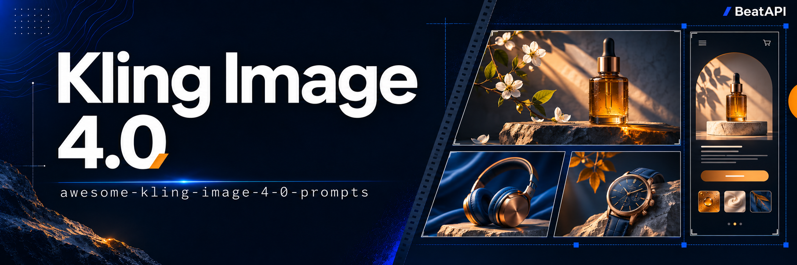

# Awesome Kling Image 4.0 Prompts

4 featured workflows with full prompts and outputs, 40 creator examples on X (15 link to the original prompts), and 50 official Kling AI references.

**[BeatAPI home](https://beatapi.io)** · **[Browse the gallery](https://beatapi.io/kling-image-4-0-prompts)** · **[Model preview](https://beatapi.io/kling-4-0-image-api)** · **[中文](README.zh-CN.md)** · **[Contribute a case](https://github.com/BeatAPI/awesome-kling-image-4-0-prompts/issues/new?template=prompt.yml)**

[Featured workflows](#featured-workflows) · [Creator examples](#creator-examples-on-x) · [Official references](#official-references) · [Prompt templates](TEMPLATES.md)

## Featured workflows

### Reading in a summer park

Kling AI official example · [Open the full example](https://beatapi.io/prompts/kling-image-4-0/summer-park-reading)

### Four-frame storybook

Kling AI official example · [Open the full example](https://beatapi.io/prompts/kling-image-4-0/storybook-image-set)

### Reference-driven style transfer

Kling AI official example · [Open the full example](https://beatapi.io/prompts/kling-image-4-0/reference-style-edit)

### Ecommerce product detail page

Kling AI official example · [Open the full example](https://beatapi.io/prompts/kling-image-4-0/ecommerce-long-form)

## Creator examples on X

- [Dive-bar group Polaroid](https://x.com/minchoi/status/2122906746310004762) · @minchoi · [Original prompt](https://x.com/minchoi/status/2122906746310004762)
- [Handheld street portrait](https://x.com/minchoi/status/2122906750839886300) · @minchoi · [Original prompt](https://x.com/minchoi/status/2122906750839886300)
- [Backyard birthday flash photo](https://x.com/minchoi/status/2122906755134886338) · @minchoi · [Original prompt](https://x.com/minchoi/status/2122906755134886338)
- [Candid beach selfie](https://x.com/minchoi/status/2122906757852741999) · @minchoi · [Original prompt](https://x.com/minchoi/status/2122906757852741999)
- [Hands folding a dumpling](https://x.com/minchoi/status/2122906761208234149) · @minchoi · [Original prompt](https://x.com/minchoi/status/2122906761208234149)
- [Overhead diner breakfast](https://x.com/minchoi/status/2122906764295197110) · @minchoi · [Original prompt](https://x.com/minchoi/status/2122906764295197110)
- [Wet dog in the back seat](https://x.com/minchoi/status/2122906768346943790) · @minchoi · [Original prompt](https://x.com/minchoi/status/2122906768346943790)
- [Wildlife photography](https://x.com/HeyZoyaKhan/status/2122728805488033955) · @HeyZoyaKhan · [Original prompt](https://x.com/HeyZoyaKhan/status/2122728805488033955)
- [Ultrawide cinematic landscape](https://x.com/HeyZoyaKhan/status/2122728839545851934) · @HeyZoyaKhan · [Original prompt](https://x.com/HeyZoyaKhan/status/2122728839545851934)
- [Typography and poster design](https://x.com/HeyZoyaKhan/status/2122728880176005405) · @HeyZoyaKhan · [Original prompt](https://x.com/HeyZoyaKhan/status/2122728880176005405)
- [Coordinated ecommerce product images](https://x.com/HeyZoyaKhan/status/2122728915966050364) · @HeyZoyaKhan · [Original prompt](https://x.com/HeyZoyaKhan/status/2122728915966050364)
- [Nine-panel skincare storyboard](https://x.com/HBCoop_/status/2122726778791948733) · @HBCoop_ · [Original prompt](https://x.com/HBCoop_/status/2122727098465026189)
- [Skincare campaign stills in Series mode](https://x.com/HBCoop_/status/2122726846106337448) · @HBCoop_
- [New poses from three character references](https://x.com/HBCoop_/status/2122726870026510542) · @HBCoop_
- [Product label detail and full image](https://x.com/HBCoop_/status/2122726893984321828) · @HBCoop_
- [Product detail and web design workflows](https://x.com/HBCoop_/status/2122726966168289361) · @HBCoop_
- [One bottle in four styles](https://x.com/HBCoop_/status/2122727017330380903) · @HBCoop_
- [English and Chinese font comparison](https://x.com/HBCoop_/status/2122727051774034284) · @HBCoop_
- [Fingertip and glass macro test](https://x.com/CharaspowerAI/status/2122718748599832869) · @CharaspowerAI
- [A character series at multiple angles](https://x.com/CharaspowerAI/status/2122718781038567449) · @CharaspowerAI
- [Typography in advertising visuals](https://x.com/CharaspowerAI/status/2122718806506394061) · @CharaspowerAI
- [Image experiments with prompts in ALT](https://x.com/DrSadek_/status/2122729546994843939) · @DrSadek_
- [Five-model greenhouse horror comparison](https://x.com/SeeAPIcom/status/2122943822929993933) · @SeeAPIcom · [Original prompt](https://x.com/SeeAPIcom/status/2122946501773320331) · Kling Image 4.0 / GPT Image 2.6 / Seedream 5.5 / MiniMax H3 Image / Nano Banana Pro
- [Three-model phone-photo comparison](https://x.com/DavidRunsAds/status/2123043289385550257) · @DavidRunsAds · [Original prompt](https://x.com/DavidRunsAds/status/2123043460852629592) · Kling Image 4.0 / Nano Banana 2.1 / GPT Image 2.6
- [Four-model anime poster comparison](https://x.com/Iancu_ai/status/2123060512284111346) · @Iancu_ai · Kling Image 4.0 / MiniMax H3 Image / GPT Image 2.6 / Seedream 5.5
- [Four-model portrait texture comparison](https://x.com/genel_ai/status/2122859430736019654) · @genel_ai · Kling Image 4.0 / GPT Image 2.6 / Seedream 5.5 / MiniMax H3 Image
- [Kling and GPT Image Japanese street portraits](https://x.com/seisei_ai_1st/status/2122714205253996865) · @seisei_ai_1st · Kling Image 4.0 / GPT Image 2.6
- [Cinematic character texture and detail](https://x.com/TechieBySA/status/2122730692706521407) · @TechieBySA
- [Character consistency across scenes](https://x.com/TechieBySA/status/2122730696430985384) · @TechieBySA
- [Four sketches translated into multiple formats](https://x.com/akiyoshisan/status/2122890189140111494) · @akiyoshisan
- [Diamond portrait detail study](https://x.com/fAIkout/status/2122878233263898888) · @fAIkout
- [Japanese flyer, menu and newspaper text test](https://x.com/FalconG_J/status/2122901983178932286) · @FalconG_J · [Original prompt](https://x.com/FalconG_J/status/2122902441175986681)
- [Cinematic lighting stills](https://x.com/aipromptsolutio/status/2122999385948815768) · @aipromptsolutio
- [Four-page rooftop manga](https://x.com/yachimat_manga/status/2122887567829881058) · @yachimat_manga
- [Fantasy RPG environment](https://x.com/333mic999/status/2123062142014550490) · @333mic999
- [Summer festival printmaking scene](https://x.com/aicreataro/status/2122894976321552509) · @aicreataro
- [Rain-themed fictional movie poster](https://x.com/shadsoha2026/status/2122902790729293851) · @shadsoha2026
- [Two-tone perfume campaign concept](https://x.com/T_st_love_love/status/2123010827649495267) · @T_st_love_love
- [Original anime key art](https://x.com/neco1751662/status/2123075296337551540) · @neco1751662
- [Street photography realism study](https://x.com/craftian_keskin/status/2122879615307849736) · @craftian_keskin

## Official references

### Coordinated image sets

- [Matching character views, set one](cases/first-character-turnaround-series.md)
- [Matching character views, set two](cases/second-character-turnaround-series.md)
- [Industrial action sequence](cases/industrial-action-storyboard.md)
- [Railway animation storyboard](cases/railway-animation-storyboard.md)
- [Romantic musical storyboard](cases/musical-storyboard.md)
- [Horror film storyboard](cases/horror-storyboard.md)
- [Art-house film stills](cases/art-house-storyboard.md)
- [Landscape environment series](cases/landscape-scenes.md)
- [School environment series](cases/school-scenes.md)

### Ecommerce & website long images

- [Ceramic pot ecommerce page](cases/pot-product-long.md)
- [Ceramic brand website visual](cases/ceramics-brand-long.md)

### Typography & layout

- [Waterside cover design](cases/waterside-cover.md)
- [Illustrated character poster](cases/illustrated-character-poster.md)
- [Minimal collage brand design](cases/collage-brand-design.md)
- [Japanese-inspired graphic poster](cases/japanese-graphic-poster.md)
- [Surreal fashion campaign poster](cases/surreal-fashion-poster.md)

### Reference-guided editing

- [Character reference sheet](cases/character-reference-sheet.md)
- [White-background character views](cases/white-background-turnaround.md)
- [Four characters in one grid](cases/matching-character-grid.md)
- [Animal pirate character lineup](cases/pirate-cast-lineup.md)
- [Reference-led product still life](cases/product-still-life.md)
- [Photoreal product lifestyle scene](cases/lifestyle-product.md)
- [Retro product styling from two references](cases/retro-product-treatment.md)
- [Render an illustrated product idea](cases/illustration-product-render.md)
- [Multi-reference outfit try-on](cases/virtual-tryon-outfit.md)
- [Retro street fashion try-on](cases/street-fashion-tryon.md)
- [Walkway fashion try-on](cases/walkway-fashion-tryon.md)
- [Y2K outfit try-on](cases/y2k-fashion-tryon.md)
- [X-ray visual style transfer](cases/xray-style-transfer.md)
- [Text layout and style transfer](cases/layout-style-transfer.md)
- [Reference style recreation](cases/style-recreation.md)
- [Identity-preserving portrait edit](cases/portrait-identity-transfer.md)

### Photography & character design

- [Reading in a summer park](cases/summer-park-reading.md)
- [Tabby on a charcoal sofa](cases/tabby-sofa.md)
- [Street portrait with a poodle](cases/cream-poodle.md)
- [Upward view through the canopy](cases/treetop-perspective.md)
- [Character portrait of Zhou](cases/zhous-character-portrait.md)
- [Mechanic character portrait](cases/mechanic-character.md)
- [Male character studio portrait](cases/western-character.md)
- [Female character portrait](cases/female-character.md)
- [Demon-inspired character design](cases/demon-idol.md)
- [Fantasy inquisitor design](cases/fantasy-inquisitor.md)
- [Fantasy creature design](cases/fantasy-creature.md)
- [Archer character design](cases/character-archer.md)
- [School uniform group portrait](cases/school-group.md)
- [Retro fashion magazine group cover](cases/retro-fashion-cover.md)
- [Documentary street portrait](cases/documentary-street-portrait.md)
- [Front-facing documentary portrait](cases/front-facing-documentary.md)
- [Everyday documentary still](cases/everyday-documentary.md)
- [Documentary character study](cases/documentary-character.md)

[50 additional original prompt templates awaiting tests](TEMPLATES.md)

## More galleries

- [MiniMax H3 Image](https://beatapi.io/minimax-h3-image-prompts) · [GitHub](https://github.com/BeatAPI/awesome-minimax-h3-image-prompts)
- [Seedream 5.5](https://beatapi.io/seedream-5-5-prompts) · [GitHub](https://github.com/BeatAPI/awesome-seedream-5-5-prompts)
- [GPT Image 2.6](https://beatapi.io/gpt-image-2-6-prompts) · [GitHub](https://github.com/BeatAPI/awesome-gpt-image-2-6-prompts)
- [MiniMax H3 Video](https://beatapi.io/minimax-h3-prompts) · [GitHub](https://github.com/BeatAPI/awesome-minimax-h3-prompts)

## Sources and reuse

Official prompts, inputs and outputs link to the original Kling AI guide or its source files. The repository license covers the original templates. [Kling AI guide](https://kling.ai/quickstart/kling-image-4-user-guide) · [CC BY 4.0](LICENSE.md).

The indexes and case files are generated from [data/catalog.json](data/catalog.json).
